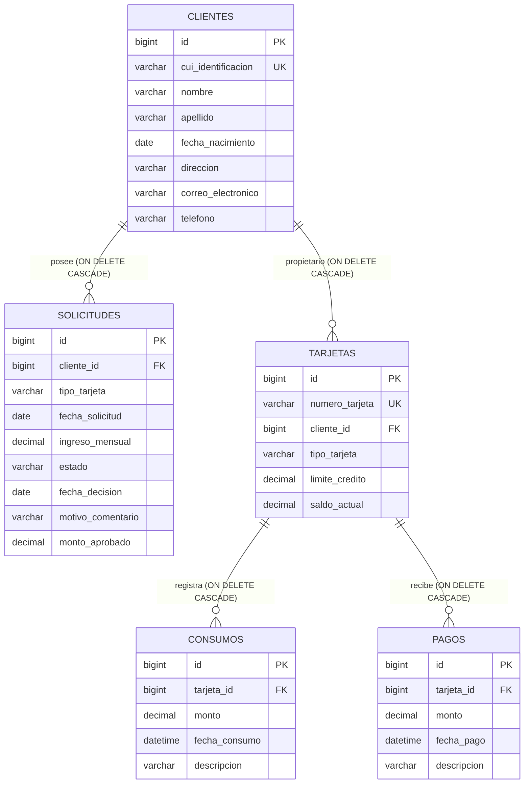

# Sistema de Gestión de Tarjetas de Crédito - CHN

El sistema es una plataforma web completa que administra el ciclo de vida de tarjetahabientes, la evaluación de solicitudes de crédito, la emisión automatizada de plásticos y el control transaccional contable.

## 🛠️ Tecnologías Utilizadas
- **Backend:** Java 17, Spring Boot, Spring Data JPA, Spring Web, Validation.
- **Frontend:** React (Vite), JavaScript, Material UI (MUI v6), Context/States.
- **Base de Datos:** Microsoft SQL Server (Transact-SQL).
- **Contenedores y DevOps:** Docker, Docker Compose.

---

## 🏛️ Arquitectura del Sistema y Patrones de Diseño

El sistema se diseñó bajo una **Arquitectura Limpia en Capas (Layered Architecture)** para garantizar el desacoplamiento, la alta cohesión y facilitar las pruebas unitarias:

1. **Capa de Presentación (Controllers / REST API):** Expone los endpoints HTTP semánticos y gestiona los códigos de estado adecuados a través de `ResponseEntity`.
2. **Capa de Negocio (Services):** Contiene las reglas operacionales del banco y centraliza la persistencia de forma atómica mediante la anotación `@Transactional`.
3. **Capa de Acceso a Datos (Repositories):** Interfaces que extiendan de `JpaRepository` abstrayendo por completo el motor Transact-SQL.
4. **Capa de Modelo (Entities):** Modelos de datos enriquecidos con anotaciones de JPA e integridad relacional.

### Patrones de Diseño Clave Aplicados:
* **Inversión de Control (IoC) e Inyección de Dependencias:** Se forzó el uso de la **Inyección por Constructor** sobre atributos directos (`@Autowired`), garantizando la inmutabilidad de los servicios y facilitando el testing aislado.
* **Manejo Global de Excepciones:** Centralizado mediante `@RestControllerAdvice` y `@ExceptionHandler`, impidiendo que el servidor exponga trazas internas de Java (`500 Error`) y retornando respuestas JSON estandarizadas.

---

## ⚙️ Reglas de Negocio Implementadas (Core Backend)

* **R01 - Identificación Única Bancaria:** Se asegura de forma estricta (mediante `@Column(unique=true)`) que ningún cliente comparta CUI en el sistema.
* **R02 - Evaluación Unidireccional:** Solo es posible procesar solicitudes de crédito que se encuentren en estado inicial `PENDIENTE`. Las solicitudes ya evaluadas (`APROBADA` / `RECHAZADA`) quedan congeladas para auditoría.
* **R03 - Emisión Automatizada:** Al marcar una solicitud como `APROBADA`, el servicio backend genera de forma inmediata un registro en la tabla de `tarjetas`, calculando un número aleatorio único de 16 dígitos y fijando el `saldo_actual` inicial en **Q 0.00**.
* **R04 - Control de Crédito Disponible:** Los consumos actúan como cargos (suman deuda al `saldo_actual`). El sistema valida transaccionalmente que `Monto del Consumo <= (Limite de Credito - Saldo Actual)`. Si se excede, la operación se declina lanzando una excepción controlada.
* **R05 - Abonos y Liberación de Cupo:** Los pagos actúan como abonos (restan deuda al `saldo_actual`). Al disminuir el saldo deudor, automáticamente se libera límite disponible en tiempo real.

---

## 📁 Estructura del Repositorio

```text
PruebaAnalistaProgramadorCHN/
│
├── backend/               # Proyecto de Servidor Spring Boot
│   ├── src/main/java/     # Lógica en capas (controllers, services, models, repositories)
│   ├── src/main/resources/# Propiedades de conexión (application.properties)
│   └── Dockerfile         # Construcción multi-etapa para el JAR de Java
│
├── frontend/              # Cliente de Interfaz Gráfica React
│   ├── src/components/    # Componentes modulares reutilizables de Material UI
│   ├── src/views/         # Pantallas principales del flujo de negocio
│   ├── src/api/           # Instancia centralizada de peticiones HTTP
│   └── Dockerfile         # Entorno Node aislado para ejecución de Vite
│
├── docker-compose.yml     # Orquestador global (SQL Server + API + React)
└── script_base_datos.sql  # Sentencias Transact-SQL con índices y cascadas
```

---

## 🚀 Instrucciones de Ejecución Local

### Prerrequisitos
- Tener instalado **Docker Desktop** y que el motor esté en ejecución.
- Tener instalado **Git** para la clonación del repositorio.

### Pasos para Desplegar el Sistema
1. Clonar este repositorio en su máquina local:
   ```bash
   git clone https://github.com/checha9i/PruebaAnalistaProgramadorCHN.git
   ```
2. Navegar a la carpeta raíz del proyecto:
   ```bash
   cd PruebaAnalistaProgramadorCHN
   ```
3. Construir las imágenes y levantar todo el ecosistema con un solo comando:
   ```bash
   docker-compose up --build
   ```
4. Una vez que la terminal indique que los servicios están listos, puede acceder a las siguientes URLs:
   - **Frontend (Interfaz Gráfica):** `http://localhost:5173`
   - **Backend (API REST Base):** `http://localhost:8080/api/clientes`
   - **Base de Datos (SQL Server):** Mapeado localmente en el puerto `1433` con el usuario principal `sa`.

---

## 🗺️ Modelo Entidad-Relación (DER)


## 👨‍💻 Autor
* **Nombre:** César Javier Solares Orozco
* **GitHub:** [@checha9i](https://github.com)